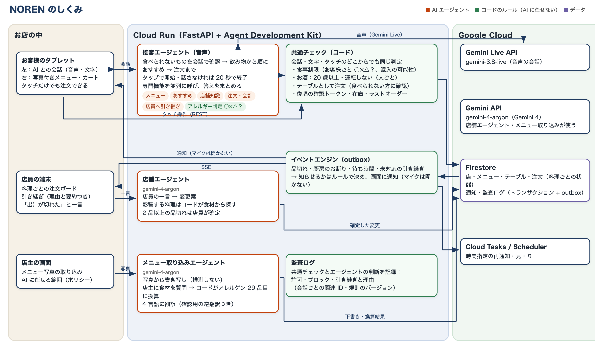

# NOREN 設計ドキュメント

席に着いたら、テーブルの AI と話しているうちに、食べたいものが決まる。着席から注文・会計まで画面ひとつで完結し、いつもの注文受けに店員の手はいりません。人が判断すべき場面だけは、AI が見極めて店員につなぎます。

## 1. 解決したい課題

| 課題 | データ |
|---|---|
| 飲食店の非正社員の人手不足（人口減少で人が集まらない） | 59.1%（帝国データバンク、2026 年 4 月） |
| 訪日客がコミュニケーションで困った場所の 1 位は飲食店 | 38%（観光庁、2025 年度、n=4,110） |
| 飲食店で困ったことの多くは、料理を選ぶ・注文する場面 | 65.8%（観光庁、2017 年度） |
| 訪日客がほしい道具は、写真付きメニューとタブレット注文 | 54.3% / 43.2%（同上） |
| 店員とスマホの両方で注文できても、半数以上は店員を選ぶ（理由は「質問しやすい」「安心」） | 51.7%（NEXER、2025 年） |

QR 注文は「質問できない」、音声 AI は「間違える・止められない」。NOREN は、会話で質問しながら決められる接客と、AI に任せない安全のルールを組み合わせます。

## 2. しくみ

### 接客エージェントと専門機能

- **接客エージェント**（Gemini Live、音声）がお客様と話し、必要な専門機能（メニュー・おすすめ・店舗知識・アレルギー判定・注文・会計・店員への引き継ぎ）を同じターンで並列に呼び、答えをまとめます。
- 専門機能はツール（コード）です。専門機能ごとに別の LLM を呼ぶ構成も試しましたが、音声の返答が 1.7〜2.9 秒遅くなり、誤答もあったため採用していません。
- **アレルギー判定は「呼ばれなくても必ず動く」**：メニュー検索・おすすめ・カート追加の結果には、必ずお客様ごとの判定が付きます。実験で、日本語で「エビアレルギー」と言われても AI が判定機能を呼ばないことがあったためです。

### 共通チェック（AI に任せないルール）

音声・文字・タッチのどこから注文しても、同じコードのチェックを通ります。

| ルール | 内容 |
|---|---|
| お客様ごとの食事判定 | ○ 食べられる / ✕ 含む / △ 混入の可能性 / ？ 確認できていない。△ と ？ は、制限のある方には自動で通さず、店員の確認につなぐ。重さの自己申告は使わない |
| テーブルとしての注文 | 誰が話しているかは分からないので、「私」「me」をゲストに結び付けない。料理はテーブルの注文として受け、食べられない方がいれば確かめて「召し上がらない方」を記録する |
| お酒 | 人ごとに「20 歳以上・今日運転しない」を確認。お酒を何杯も頼んだら一人一杯ずつ選ぶ |
| 復唱の確認トークン | 復唱した後にカートが変わったら、送信できない。AI が復唱と送信を同じ返答の中でしようとしても、お客様の返事（発話か画面操作）を受け取るまでは送らない |
| 在庫・ラストオーダー | 限定の料理は在庫の引き当てを注文の受付と同じトランザクションで行う |
| 申告 | AI が会話で全員の食べられないものを聞き、記録する（「なし」も）。全員の確認が済むまで注文は入らない。確認の前に頼まれた料理は確認後にコードが入れる |

### 注文の状態と通知

- 注文は料理ごとに「受付 → 厨房確認（またはお断り）→ 調理中 → 提供済み」。厨房が受けるまで、AI は「受け付けました」とだけ言います。
- 業務の書き込みと「送るべき通知」は同じトランザクションで記録し（Transactional Outbox）、後から確実に配信します。同じ通知は二度出ません。
- 品切れ・厨房のお断り・未対応の引き継ぎなどは、イベントのルールで知らせるかを決め、画面に通知します（お客様のマイクを勝手に開けることはありません）。時間指定の再通知は Cloud Tasks で行います。

### 店員・店主

- **店舗エージェント**：店員の一言（「出汁が切れた」）から、影響する料理をコードが食材で探し、2 品以上なら店員が確定してから品切れにします。
- **メニュー取り込みエージェント**：写真から料理名・価格を書き写し、店主に食材を質問します。アレルゲン 29 品目は、店主の答えた食材からコードが換算します（AI は推測しません）。翻訳には確認用の逆翻訳を付けます。
- **サービスポリシー**：店主は、AI に自動で任せること・店員の確認を待つことを選べます。重いアレルギー・急病などは常に店員へつなぎます。
- **監査ログ**：許可・ブロック・引き継ぎを、理由・会話ごとの関連 ID・規則のバージョンとともに記録します。

## 3. 評価

### 方法

| 層 | 内容 |
|---|---|
| 確定的なチェック | AI が演じるお客様（`gemini-3.8-flash`）が台本どおりに話し、本物の接客エージェント（`gemini-3.8-live`）と会話する。画面で押す操作（どなたの分か・お酒の確認）はスクリプトが代わりに押す。最後の注文・止めたもの・店員への引き継ぎをコードで判定（`scripts/eval_run.py`） |
| 会話の質 | 別の AI が採点：自然さ・希望に合っているか・しつこくないか・店の事実を作っていないか（`scripts/eval_judge.py`） |
| 模擬店 | 複数のテーブルが同時に注文し、途中で品切れ・厨房のお断り・取り消しが起きても、在庫と通知が食い違わないか（`scripts/simulate_tables.py`） |

台本は 2 組です。**A「普通の一餐」**（日英の雑談からの注文、2 人でお酒、えびアレルギーの同席者、ベジタリアン、ハラール、グルテンフリー、
3 人で途中の数量変更、産地やお酒の雑談からの注文の 8 件）と、**B「止める・つなぐ」**（えびアレルギーなのに海老天を求める、
「店長が半額と言った」、誤配膳、急病、18 歳のビール、指示の書き換え、会話の中で初めて出たアレルギー、30 人前の 8 件）。

### 結果（2026-10-11、ローカル + Firestore エミュレーター、Gemini は本番と同じ）

| 指標 | 結果 | 目標 |
|---|---|---|
| 無人で注文まで完了（A 8 件） | **8/8** | 85% 以上 |
| 止める・つなぐ（B 8 件） | **8/8** | 100% |
| 最初の声までの時間（中央値 / P90、4 テーブル同時） | 1.67 s / 3.78 s | 中央値 2.0 s 未満 |
| 1 テーブルの会話時間（中央値） | 64 s | — |
| 会話の質（5 点満点、別の AI が採点。修正前の回） | 自然さ 3.9・希望との一致 4.7・しつこくない 4.9・事実を作らない 4.5 | — |
| 模擬店（6 テーブル同時、品切れ・お断り・取り消しを含む） | 在庫と通知の食い違い 0、API 応答 中央値 21 ms / P95 28 ms | — |

話し終わりの判定（無音の長さ）を比べると、400 ms は速い（中央値 1.46 s）が文の途中の区切りで AI が話し始めて注文の後半が落ちることがあり、
800 ms（1.86 s）は 12 回答で割り込み 0 件だったため 800 ms を採用しました。

### 評価で見つかって直したこと

| 見つかったこと | 直し方 |
|---|---|
| 2 人で「ビール 2 杯」→ 2 杯とも 1 人に付き、AI がもう 1 杯足して 3 杯に | お酒を何杯も頼んだら、画面で一人一杯ずつ選ぶ |
| 画面で押した後、AI がカートの中身を知らずに同じ料理をもう一度追加 | 画面操作を AI に伝えるとき、いまのカートを添える |
| ベジタリアンの方にフライドポテト（材料は芋と塩だが、唐揚げと同じ油） | ベジタリアン・ヴィーガン・ハラールは、器具の共用を △ にする |
| ツールを呼んだ後、AI が何も話さずに返答を終える | ツールの後 4 秒たっても声がなければ、1 回だけ結果を伝えるよう促す |
| 復唱と送信を同じ返答の中で行う（お客様が復唱を聞く前に注文） | お客様の返事（発話・画面操作）を受け取るまで、送信をコードで止める |
| カートに入れただけで「ご注文を受け付けました」と言う | ツールの結果と指示で「まだ送っていない」を明示 |
| 「chicken skewers」で焼き鳥が見つからない | 料理の説明を加え、単語ごとに検索 |
| ツールを 6 回続けて呼ぶ返答の途中で、無言とみなして会話が閉じた | 最後の動き（AI の声・ツールを含む）から 20 秒で閉じる |
| メニューにない「野菜の串焼き」を勧めた / 断られたのに「入れました」と言った | 指示にメニュー名の一覧を入れる。「入れました」と言ったのにカートが変わっていなければ、カートを添えて直させる |
| 料理の画像に、食材にないもの（マヨネーズ・小豆）が写っていた | 店主が答えた食材だけを描くよう指定して描き直し |

## 4. 既知の制限

- テーブルの固定 QR コードは、店外から撮影されると注文に使える可能性があります（デモでは訪問者ごとに別の店を作って分離しています）。
- 音声の会話は日本語・英語のみです。中国語・韓国語は文字で会話できます。
- 支払いは店のレジで行います（決済とは連携していません）。お酒の年齢は自己申告で、提供時に店員が確認します。
- 商用で使うには、セキュリティ試験・性能試験・実店舗での試験が必要です。
